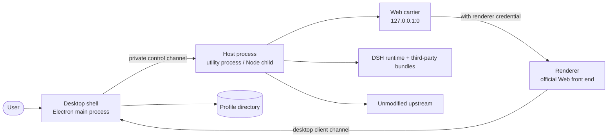

# DSH Desktop Architecture

DSH Desktop is a desktop product built around the **unmodified DeepSeek Harness upstream**: an Electron shell plus a Host process that runs the official Web application, with the upstream renderer as the front end. This repository does not change upstream semantics; it fills in what a desktop form factor needs at the process boundary, in profile composition, packaging and the release channel.

This document describes the code as it stands (HEAD `f89d121`, product version 2.1.18, DSH Beta runtime `0.2.1-rc.3`). Where it disagrees with the code, the code wins.

## Overview



There is exactly one criterion: **no runtime state that crosses this boundary may be cached.** The shell does not assume which plugins the Host has, which generation it is on, or what the active profile is called; the Host does not assume the window still exists. Each side owns its own state and reconciles through messages.

There are two shells in this repository and they are **two different implementations** that share one upstream runtime:

| | `dsh-plugin-desktop-beta` | `nonead-dsh-desktop` |
| --- | --- | --- |
| Channel | Beta (`dsh-plugin-desktop-beta`) | Stable (`nonead-dsh-desktop`) |
| Host process | Electron `utilityProcess.fork` | Electron running a Node-mode child with `--expose-internals` |
| Control channel | Private RPC (`{ kind, id, method, args }`) | Node named IPC messages (`process.send`) |
| Renderer credential | 32 bytes per generation, base64url, same HTTP header | Same header, constant lives in `src/desktop-contract.ts` |

Both shells are at version 2.1.18 and their feature sets largely match, but their Host lifecycles are entirely different. Before relying on any statement below, check which shell it applies to.

## Startup order

Taking the Beta shell as the example (`dsh-plugin-desktop-beta/src/main.ts`):

1. `app.requestSingleInstanceLock()`. Without the lock the process exits and hands its arguments to the running instance.
2. `await app.whenReady()`. Only after this do Electron windows, trays and native APIs exist.
3. `prepareDesktopProfile(...)` resolves the profile directory, composes the ordered patch layers, writes the root config as `[]` if it is not already, and computes `bareModuleBaseUrl`. This step also decides which market provider this generation uses.
4. If `DSH_DESKTOP_ISOLATED_HOST !== '0'` (the default), `startIsolatedDesktopHost(...)` starts the Host process; set it to `0` to boot in the same process, which is only useful for debugging.
5. Inside the Host, in order: install the outbound proxy policy (it must run before boot, because plugins make requests as they mount) → create the Host runtime bridge → create the renderer access decision → create the LAN HTTPS runtime (`prepareCertificate` calls back into the shell over RPC) → `bootDesktopHost(...)` loads the patch layers and runs profile boot → `mountScheduled()`.
6. The carrier binds `127.0.0.1:0` (system-assigned port). The Host returns `{ pid }` as the result of the `boot` call.
7. The shell takes the credentialed URL, creates the window and lets the renderer load; it then registers the tray and the update lifecycle.
8. Only after the window has loaded is this start recorded as last-known-good. Startup failures are never recorded as good.

## The private control channel between shell and Host

### Beta shell: utility process plus private RPC

The Host is started with `utilityProcess.fork('./host-process-entry.js', [], { serviceName: 'DSH Host', stdio: 'pipe' })`. The entry point only recognises `process.parentPort`; without it, it throws `DSH Host must be started by the Desktop supervisor`, so it **cannot** be run standalone. The entry point imports no `BrowserWindow` and no Electron main-process API.

The channel lives in `src/host-rpc.ts` and has three message shapes:

```ts
{ kind: 'call',   id, method, args }
{ kind: 'result', id, value } | { kind: 'result', id, error }
{ kind: 'cancel', id }
```

`id` must be a positive safe integer, otherwise the whole message is dropped. Registering the same method twice throws `Duplicate Host handler: <name>`; calling a method that does not exist throws `Unknown Host operation: <method>`. The default timeout is 30 seconds; both sides of the Host lifecycle construct it with 120 seconds. Closing the channel rejects every pending call.

The method set is deliberately tiny:

- The shell registers `certificate` (issues the LAN HTTPS certificate) and `quit` (the Host asks the shell to exit; the shell runs it in `setImmediate`).
- The Host registers `status` (returns `{ pid, services }`), `stop` and `boot` (`args` are `[wire, snapshot, token]`).

Web traffic does **not** pass through this channel.

### Stable shell: Node-mode child plus named messages

The Stable shell spawns `@deepseek-ai/dsh-desktop-host` with `spawn(node, ['--expose-internals', ..., entry, runtimeDir, projectDir, primaryRuntime, pnpm, nodeBin], { stdio: ['ignore','pipe','pipe','ipc'] })` and reconciles over IPC messages. Host → shell messages are `ready`, `fatal`, `platform-session`, `platform-login`, `injections`, `permission`, `logging-config`, `browser-access`, `notification`, `shutdown-complete`, `desktop-action` (`restart` / `terminal`) and `update-tasks`; shell → Host messages are `shutdown`, `logging-config`, `browser-access`, `injections`, `update-tasks` (`inspect` / `lock` / `unlock`) and `permission-result`. Every event goes through an allowlist; a malformed shape is treated as a fault (`dsh desktop host sent an invalid IPC event`) rather than answered by guesswork. Request-shaped messages carry a `requestId` and the shell waits 5–10 seconds before failing.

### Stopping order

Neither side trusts "the message was sent" as proof that the process stopped.

Beta: `rpc.call('stop')`, aborting that call after 3 seconds → `child.kill()` → if it has not exited within 1 second, throw `DSH Host termination was not confirmed` → release the native bridge → close the RPC channel.

Stable: `shutdown` → wait 10 seconds → `SIGTERM` → wait 5 seconds → `SIGKILL` → if it still has not exited after another 5 seconds, throw `dsh desktop host did not exit after SIGKILL`. When the normal exit path requires a clean exit, an unclean one throws `DesktopHostUncleanExitError` carrying the exit code, signal and acknowledgement diagnostics.

On an unexpected Host exit both shells put the tail of stderr into the desktop log: Beta keeps the last 16 KiB and formats `reason + Last DSH Host stderr: ...`; Stable keeps 64 KiB. Inside the Host the contract is fail-loud (`installFailLoud`) — an unhandled rejection does not leave it serving from half a state; it reports, releases what this generation holds and exits 1.

### Renderer credential: only two kinds of HTTP traffic reach the Host

The carrier admits exactly two kinds of request: those carrying the correct renderer credential (`renderer`) and ordinary browsers when allowed (`browser`, only in compatibility mode with browser access enabled by the user). Everything else is `denied`.

- The credential is 32 random bytes per generation, base64url-encoded (43 characters), sent in the `x-dsh-desktop-renderer` header and compared with `timingSafeEqual`.
- Any request URL whose query keys start with `dsh-desktop-` is treated as carrying renderer markers; a request with markers but no valid credential gets a 403, so the credential cannot leak through a link.
- Upgrade requests are decided the same way: a refusal writes `HTTP/1.1 403 Forbidden`.
- Transport: the main process writes it into the Host child's **private stdin** (one line, then `end()`), and the Host reads and shape-checks it after its argv and `process.send` guards; it **never enters the environment, argv or a file**. An unusable pipe is a hard failure, not a silent downgrade.
- The Host HTTP gate **fails closed** when the credential is missing (one `browser-access.unavailable` warning): without it the Host cannot tell the Electron renderer from an ordinary browser, so permitting would just open browser access. Mutating requests outside the `/connect` family and the read-only methods additionally have to pass `connection.requestRejection`.

## Platform adapters

Platform differences are funnelled into one seam, `ElectronPlatformStrategy` (`src/electron-platform.ts`), chosen at startup: `platform`, `updateDownloadPlatform`, `canPickDirectory`, `canToggleShellMode`, `hidesWindowOnClose`, plus `configureApplication` / `refreshApplicationMenu` / `configureWindow`.

Two things are easy to get wrong:

- The Windows strategy calls `window.removeMenu()`; the menu exists only on the tray and native-menu paths.
- **`hidesWindowOnClose` is `false` on Linux.** `new Tray()` always succeeds on Linux even where the desktop has no status area, and a hidden window then becomes unreachable. So on Linux closing the window minimises it: the Host and its sessions keep running, and the window stays in every window list, alt-tab ring and overview.

### Window material

Material narrows per platform: macOS is `off | transparent` (default `transparent`), Linux accepts `off | transparent`, but both resolve to `off` (default `off`), and **Windows only has `off`**. The legacy `acrylic` and `mica` values still parse, but both resolve to `off` — those two backdrops break compositing with the renderer.

## Profiles, patch layers and the config writer

The profile directory comes from `@deepseek-ai/dsh-app-boot`'s `resolveProfileDir(name, home)` and lives at `<DSH_HOME>/profiles/<name>`. The Beta shell's desktop profile name is fixed and created with `ensureDesktopProfile` on first start; other names are resolved but not created. `list()` is read-only and `select()` records a pending selection and then requests a restart, so the UI never shows a switch that did not happen.

### Patch layer order

`prepareDesktopProfile` composes one ordered patch list:

1. Each active bundle layer's own patches, in the order of the profile's `dsh.profile.bundles`.
2. Immediately after the `@deepseek-ai/dsh-web-app` layer, the shell's own overlay, `loadOverlayPatches(BIN_NAME, DESKTOP_PATCH_PATH)`.
3. The machine-wide patches from `loadDesktopMachinePatches(home)`, with unresolvable optional entries filtered out by `omitUnresolvedOptionalEntries`.
4. All three then pass the market-provider filter; on a provider conflict the generation runs as `disabled` rather than picking a winner.

A profile missing `@deepseek-ai/dsh-web-app` throws `<bin>: desktop profile is missing @deepseek-ai/dsh-web-app` — better a clear failure than a half start.

### Two patch forms

```yaml
- id: web-runtime          # override fields on the row with this id
  config:
    openBrowser: false
- insert:                  # append new rows
    - id: example-capability
      name: example-plugin
```

`- id:` is a **field override**: `config` replaces the row's config wholesale and `name` acts as an assertion (a mismatch skips the entry). `- insert:` appends one loader entry.

### Three ways a patch fails

What a mistake costs depends on which mistake it is, and this is the easiest part of the layer to get wrong:

| What is wrong | What happens |
| --- | --- |
| `id` matches no row | Logs an `entry not found` warning; the other patches still apply |
| `name` does not match the row's actual module | Logs `name mismatch ... skipping`; that one entry is skipped |
| An `insert` names a service missing from the runtime | The service stays pending forever with **no warning**; externally it looks like an HTTP 4xx |

The third is the expensive one: no error, just a half that never comes up. The order of investigation is whether the inserted module name can actually be resolved from the profile.

### Patch layers the shell contributes

- The Beta shell's `cordis.patch.yml` inserts `desktop-shell` (config `mode: compatibility`), `desktop-terminal` (`disabled: !!js process.platform === 'linux'`), `desktop-diagnostics`, `desktop-notifications`, `desktop-pnpm`, `desktop-profiles` and `desktop-updates`; it then overrides `web-runtime` by id (`openBrowser: false`, `printUrl: false`, `surfaceContext: true`, `trustedHosts: []`) and disables `command-feedback`. It also names `host.cordis.patch.yml` in its own config to disable the upstream `webserver` and swap in the desktop implementation bound to `127.0.0.1:0`.
- The Stable shell re-enables `ui-sidebar-browser`, inserts its own capability row and skin, and explicitly disables upstream product analytics (`desktop-product-telemetry`, `product-analytics`) — upstream reports by default for any profile named `desktop`, and this product does not participate.

### Profile directory and the single writer lock

Reading and rewriting a profile must happen under **one writer lock** (`src/recovery-support.ts`). An unlocked cycle can read a state another writer has already replaced and write it back, silently dropping that writer's change. The lock file is `<profile>/lock.lock`: created exclusively, stamped with the holder's pid, and adoptable once that process is gone. It contends for the same lock as `@deepseek-ai/dsh-atomic-write`'s `withFileLock`, so in-process and out-of-process writers see each other. The wait budget is 2 seconds with retries backing off from 20ms to 200ms, and an in-process depth table prevents self-locking and leaks.

Recovery mode operates on profile snapshots under that same lock and can return to any saved snapshot, not just the previous one.

## Updates, recovery and desktop behaviour

- **Release notes** appear in the update card, the tray hint and the native dialog. The summary is the first non-empty line, whitespace collapsed, cut at 120 code points; with no notes the stored text stays consistent with the previous state instead of becoming `undefined`. Native dialogs cannot be cancelled, so they are only opened once the abortable version request and file state are ready.
- **Skipped versions** persist in `<userData>/next-updates/skipped-version.json` and are read once per process. A version must match `\d+.\d+.\d+` plus an optional pre-release suffix; a corrupt record reads as "nothing skipped" so bad data cannot block updates. Clearing a skip **writes an empty object** instead of deleting the file, keeping the "regular files only" guarantee.
- **Install retry**: `retryInstall` reuses the downloaded package instead of downloading again.
- **Window state** persists into a private directory: default 1280×840, minimum 800×580. A saved position is only reused if it overlaps some mounted display's work area by at least 160×80; otherwise it falls back to the default position. Moves and resizes coalesce into a 500ms write, and corrupt or out-of-range records fall back to defaults.
- **Strict `.env` layering**: the desktop only **fills in missing variables** for the Host child; it never overrides existing values. Only `KEY=VALUE` is accepted — no expansion, escapes or inline comments — the first assignment of a key wins, and every skipped line produces a warning with its line number rather than being swallowed.
- **`dsh-desktop://` deep links**: `src/deep-link.ts` parses `dsh-desktop://settings/general`, `dsh-desktop://open?path=/x` and `dsh-desktop:open`; actions are lower-cased, the first of duplicate query keys wins, and an empty action counts as malformed. `src/preload-deep-link.ts` forwards the link to the renderer and validates its shape. Actions go through an allowlist (`DEEP_LINK_ACTIONS = ['settings', 'open']`): the main process drops unknown actions **before queueing** and logs one warning, so the `did-finish-load` replay cannot bypass it — any local process can send `dsh-desktop://<action>`, and this allowlist is the only constraint on that path.
- **Open at login** (`src/login-item.ts`): a failed read means off, so the toggle never claims a start-up entry that does not exist; a write is read back before it returns.
- **Unhandled renderer errors** surface in the notification area instead of vanishing into a console nobody reads.

## Packaging and runtime closure

Packaging is electron-builder. The **Stable shell** (`asar: true`) produces `app.asar` plus `app.asar.unpacked`; the **Beta channel** ships a physical directory (`asar: false`), so its payload is a plain file tree under `resources/app/` and `asarUnpack` means nothing for it — `dsh-plugin-desktop-beta/tests/package.spec.ts` asserts `build.asar === false` and that `asarUnpack` is absent. The Stable shell adds a payload assembly step independent of electron-builder (`nonead-dsh-desktop/scripts/prepare-payload.ts`): it first runs electron-builder's own manifest transformer (so the sealed bytes are the final bytes), then collects the production closure along Node resolution paths, and finally `sealPayload` writes a `desktop-runtime.json` (`schemaVersion: 1`, per file `{ path, bytes, sha256 }`).

Four boundaries:

- The production closure is `dependencies` + non-optional peers + installed optional dependencies.
- Only literal names and `directory/**` are accepted; any other `files` spelling is rejected.
- Type-only dependencies are demoted to optional peers or devDependencies and never enter the closure.
- Placement is decided by resolving *from the dependent* (`createRequire(...).resolve.paths`, accepting only directories whose basename is `node_modules`, never `exports`), so a change in hoisting layout cannot silently swap payload files.

## Release-channel protocol

`upstream.json` defines two channels:

| Channel | Vendored runtime | Upstream commit | Workspace package |
| --- | --- | --- | --- |
| stable | `0.2.0-rc.2` | `639ed015` | `nonead-dsh-desktop` |
| beta | `0.2.1-rc.3` | `1f81c047` | `dsh-plugin-desktop-beta` |

Two boundaries to keep straight:

- The channel name equals the vendored runtime line; it is not the workspace directory suffix. The `-beta` suffix is a package name, not "this installation chose the Beta channel".
- Update requests carry `X-DSH-Desktop-Channel` and `X-DSH-Desktop-Version`; downloads carry `X-DSH-Desktop-Target-Version`. The stable channel accepts only final SemVer, the Beta channel accepts `-beta.N`, and an old client without the channel header is treated as stable.

## Known limitations

- **An `insert` naming a service that does not exist stays pending silently** (third row of the table above): no warning, only external symptoms.
- **The `Resources/runtime` interpreter tree is outside the payload seal**: `desktop-runtime.json` covers the application payload, while the interpreter tree is installed by another path and its digest is not covered.
- **`payloadDigest` is written but not verified**: the digest recorded in `runtime.json` is not recomputed and compared at startup, so integrity rests on the bundled seal and on a server-side digest that is not published yet.
- Those checks live in the Stable shell (`nonead-dsh-desktop/src/update-installer.ts`); the Beta shell has no such module and just validates magic bytes and size before executing.
- **Windows only compares PE version resources**: stricter signature and publisher checks were introduced for 2.1.15 and then removed wholesale in `c5896ac`; there is no Authenticode verification and no publisher identity check today.
- macOS verification is stronger: bundle identity, manifest, code signature and Team Identifier all participate, and failures go through Squirrel.Mac's failure path.
- The server does not publish installer digests yet, so the final word on download integrity is still the bundled seal.
- **Electron fuse values can only be observed on a packaged artifact**: `verify-fuses` / `verify-electron-fuses` are unit-tested only; the real values are checked on the packaged artifact by `afterPack`/`afterAllArtifactBuild`, and the first true confirmation is the CI `desktop-windows-stable` job (`corepack yarn package:dir:stable`). `enableEmbeddedAsarIntegrityValidation` therefore stays off — electron-builder 26.15.7 cannot be shown to inject the integrity blob into the executable (`patches/app-builder-lib@26.15.7.patch` contains no such code) and the Windows/Linux artifacts are unsigned, so enabling it blind would stop the app from starting.

## Related documents

- [Plugin development](plugin-development.en.md)
- [Plugin ecosystem](plugin-ecosystem.en.md)
- [FAQ](faq.en.md)
- [Desktop shell service reference (Beta)](../dsh-plugin-desktop-beta/docs/plugin-services.md)
- [Upstream DeepSeek Harness](https://github.com/deepseek-ai/deepseek-harness)
