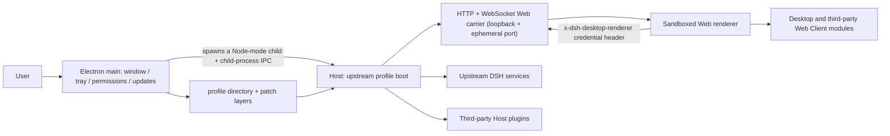

# DSH Desktop Architecture

## Overview

DSH Desktop is a thin Electron host built from two parts that run in different processes:

- **Desktop shell (Electron main process)**: windows, tray, permissions, terminal, updates, data directory, and profile state.
- **Host (a Node-mode child process)**: runs an upstream profile (the `@deepseek-ai/dsh` profile boot) against the runtime the installation carries, then exposes the official Web UI over an HTTP/WebSocket Web carrier.

The only channel between them is child-process IPC. Desktop does not create a second renderer plugin system and does not expose Electron APIs to the page: the renderer gets the official Web UI plus an access capability separated by a native credential header.

Criterion: **no state may be cached across this boundary.** The shell and the Host are two processes; a profile or mode switch disposes the whole Host generation and replaces the child. Service references, window objects, and subprocess handles do not cross generations.

## Startup order

1. Electron acquires the single-instance lock, resolves the data directory, and reads Desktop-owned profile/mode state.
2. The shell prepares the active profile (initializing it when needed) without modifying profiles merely to list them.
3. The shell passes the current generation's runtime directory, profile directory, primary runtime, packaged pnpm, and Node shim directory as argv and spawns the Host child in Node mode.
4. The Host child loads the profile's patch layers and starts the upstream profile boot. Desktop-owned capability rows are registered before third-party entries can consume them.
5. `dsh-base`, `dsh-web-app`, and the selected profile's third-party bundles compose the Web carrier.
6. The carrier binds loopback (LAN exposure requires an explicit preference) on a preference-controlled port that defaults to `0`, meaning the system assigns an ephemeral port.
7. The Host hands the credentialed URL and the Web boot injections back over IPC; the shell creates the `BrowserWindow` and loads that same-origin page.
8. The tray is created only after the Web surface loads, and the profile is committed as last-known-good.

## Desktop shell, Host child, and the access boundary

### The Host is a child process, not a generation inside the shell

The shell starts the Host with `--expose-internals`; the entry is `@deepseek-ai/dsh-desktop-host` inside the runtime directory, and the arguments are the runtime directory, the profile directory, the primary runtime directory, and the packaged pnpm and Node shim directories. Its lifetime belongs to the shell: `stop()` asks it to exit gracefully (a `shutdown` message), sends `SIGTERM` after 10 seconds, and `SIGKILL` 5 seconds after that. When an update installation requires a graceful exit, any downgrade along that path counts as a failure and refuses installation.

### The messages on the IPC channel are this layer's public surface

The shell and the Host share exactly one channel, `process.send` / `process.on('message')`, and both sides validate message shapes; an unrecognized shape is treated as a Host failure. The messages that exist today fall into three groups:

- **Host → shell**: `ready` (credentialed URL plus Web boot injections), `fatal` (message plus full diagnostic), `shutdown-complete`, `notification`, `desktop-action` (`restart` / `terminal`), and the replies for `update-tasks`, `injections`, `logging-config`, `browser-access`, and `permission` (the shell replies `permission-result`), plus `platform-session` and `platform-login`.
- **Shell → Host**: `shutdown`, `logging-config`, `injections`, `browser-access`, `permission-result`, `update-tasks`.
- **Host launch arguments**: runtime directory, profile directory, primary runtime directory, pnpm entry, and Node shim directory.

Criterion: **plugins must not open a second IPC channel or read these messages.** This is the shell-to-Host private handshake; desktop capabilities go through `desktopProfiles` / `desktopPnpm` (see [plugin development](plugin-development.en.md)).

### A native credential header separates renderer access

The Host binds loopback only, on a port the system assigns by default, so "the port answers" is not proof that a request came from the local Electron renderer. The shell mints one 32-byte base64url credential per Host generation and delivers it as the `x-dsh-desktop-renderer` request header. The Host's Web server classifies every HTTP and upgrade request into three outcomes: a correct credential is `renderer`, a disabled ordinary-browser mode or a URL carrying a `dsh-desktop-` renderer marker is `denied` (403), and everything else is `browser`.

While `browserAccess` is off, existing browser WebSockets are actively destroyed while native renderer streams stay alive, and a marker-carrying URL can never activate Desktop-only client effects from an ordinary browser.

## Platform adapters

Platform differences live at the `ElectronPlatformStrategy` seam selected once during startup. The Windows, macOS, and Linux adapters declare directory-picking, shell-mode, and update-download capabilities and own their platform-specific menu, Dock icon, and native-material operations. New platform branches belong in the corresponding adapter; the generation and runtime retain only the lifecycle shared across platforms.

Window material converges on capability: macOS and Linux accept `off` / `transparent`, Windows accepts only `off` (the legacy `acrylic` / `mica` preferences read as `off`), and Linux `transparent` fails closed to `off` because the upstream compatibility client paints an opaque background.

## Profile directory and patch layers

A profile's name and absolute directory are `$DSH_HOME/profiles/<name>`, decided by the shell and handed to the Host as argv; they must not be inferred from settings, a URL, or `$DSH_HOME`. `list()` is read-only discovery. `select()` records a pending target and completes the switch through restart.

### Patches match by row id, and a mistake is not an error

A profile is composed by stacking patch layers in this order: **each bundle's own patch → the profile's user patch `cordis.patch.yml` → launcher-supplied overlays** (the runtime's `host.cordis.patch.yml`, the shell-generated profile overlay patch, and the preference-derived runtime patch).

A patch has two forms with completely different semantics:

- **`- id: <row id>` plus field overrides**: matches an existing row by **row id** and replaces the fields given (`config` is replaced wholesale, not deep-merged); `name` is an assertion rather than a rename — a mismatch skips the patch.
- **`- insert: [...]`**: appends new rows; with an `id` it inserts into that row's group, without one it appends at the top level.

**Criterion: a wrong row id, package name, or injected service name never throws — it fails silently.** There are three distinct symptoms, and this is the order to check them in:

| What is wrong | Actual behavior |
| --- | --- |
| A patch `id` matches no row | The Loader logs an `entry not found` warning and skips the patch; startup proceeds normally |
| A patch `name` does not match the target row | The Loader logs `name mismatch ... skipping` and skips the patch |
| A plugin's `inject` service name does not exist | The plugin never activates (pending) and produces no warning; its routes, commands, and tools never exist |

The third is the hardest to diagnose: the UI only shows "some endpoint mysteriously returns 4xx" and the logs carry no corresponding error. To see both configuration styles, read the two examples the repository ships: [`nonead-dsh-desktop/cordis.patch.yml`](../nonead-dsh-desktop/cordis.patch.yml) (disables upstream rows by `id`, then `insert`s its own) and [`dsh-plugin-desktop-beta/cordis.patch.yml`](../dsh-plugin-desktop-beta/cordis.patch.yml).

### The patch layers the shell contributes

- **The runtime's `host.cordis.patch.yml`**: disables the upstream `webserver` row and substitutes its own Web server row bound to `127.0.0.1` on port `0`.
- **The runtime patch rewritten on every start**: writes the preference port and the shell-resolved trusted hosts into row config, so changing the port is a "restart the Host" boundary rather than a "restart the app" one.
- **The shell's own bundle patch**: declares which upstream rows the Desktop shell bundle disables and which rows it inserts.

## Packaging and runtime closure

Release artifacts use Electron Builder and `app.asar`, while dependencies that must be physical (for example pnpm, node-pty, Windows ACL/native files, and the `node-bin` shim directory) live under `app.asar.unpacked`. The packaged-runtime gate checks both archive entries and physical runtime entries; profile fallback links must not target virtual ASAR paths that Node cannot resolve.

The Desktop payload is not derived on the fly by Electron Builder. [`nonead-dsh-desktop/scripts/prepare-payload.ts`](../nonead-dsh-desktop/scripts/prepare-payload.ts) assembles it independently and seals it with a digest first; Electron Builder merely moves the result into the installer. Three boundaries matter to plugin authors:

- **The production closure is `dependencies` + non-optional `peerDependencies` + installed `optionalDependencies`.** A workspace package is copied through the "publish by its `files` list" path exactly when its real on-disk path contains no `node_modules`; otherwise its whole directory tree is copied.
- **`files` accepts only literal names and the `directory/**` form.** Any other glob (for example `lib/*.js`) fails the build rather than guessing a near match.
- **A local plugin's type-only dependencies must be demoted to optional peers or left in `devDependencies`.** A package referenced only by types but left in `dependencies` is treated as a runtime dependency, shipped inside the installer, and wastes space in every user profile — and a version conflict can fail closure collection outright.
- **`node_modules` placement follows resolution from the dependent.** A package resolved from two different dependent containers is copied twice; one destination claimed by two distinct sources fails the build. A local plugin's dependency versions must therefore match what the installation already carries, or be declared optional.

After sealing, the in-installer payload is verified separately (file digests plus executable file types), so "the build succeeded" and "the installation is still intact" are two separately evidenced conclusions.

Two known gaps: the interpreter tree under `Resources/runtime` (Python, Node, and the unpacked wheels) sits outside that seal, and `runtime.json`'s `payloadDigest` is written but never verified — it is also computed before the Python prune rewrites the tree, so it cannot serve as post-install content evidence until the writer's order changes.

## Release-channel protocol

`upstream.json` records each channel's upstream version, commit, and vendored-runtime manifest, and exact root resolutions ensure that each workspace resolves only its own DSH runtime. Today it records two vendored-runtime lines:

| `upstream.json` channel | Upstream version / commit | Consumer | Product identity |
| --- | --- | --- | --- |
| `stable` | `0.2.0-rc.2` | `dsh-plugin-desktop-beta` | `dsh-plugin-desktop-beta`, `DSH Desktop Beta`, `ai.deepseek.dsh.desktop.beta` |
| `beta` | `0.2.1-alpha.5` | `dsh-plugin-desktop-beta`; the Desktop shell **freezes** one runtime of the same version | `Nonead DSH Desktop`, `ai.deepseek.dsh.desktop` |

> Two boundaries that are easy to confuse. **① A channel name in `upstream.json` names a vendored-runtime line**, deciding which upstream runtime gets baked into which installer — not which release channel some workspace queries. The Desktop shell pins every `@deepseek-ai/dsh*` dependency to exactly `0.2.1-alpha.5` (the `beta` line) and ships that runtime **frozen**, so the shell's runtime version does not follow later update checks.
> **② A workspace suffix is not a channel.** `nonead-dsh-desktop`'s script suffix is `:stable`, but that is workspace naming; its own update check declares `channel: 'stable'`, matching its `Nonead-DSH-Desktop-*` artifact prefix and its release-SemVer versions (currently `2.1.3`) — the stable channel accepts only release SemVer, so all three must change together.

Version checks and installer downloads send `X-DSH-Desktop-Channel`. A check also sends the current version (`X-DSH-Desktop-Version`); a download sends `X-DSH-Desktop-Target-Version`, and the service must echo the requested channel and version. Legacy clients without the channel header are treated as stable; a `beta` client requires an explicit `channel: "beta"` response. Stable accepts only release SemVer, while Beta accepts only `-beta.N`. The `channel` field in the response is the gate that separates the streams, and the client will not silently cross channels.

The service must implement these selection and echo rules, with complete platform artifacts for the relevant channel, before a release becomes discoverable.

## Known limitations

- **A wrong `inject` service name becomes a silent pending plugin** (see the table above). When a plugin depends on a service name the current runtime does not provide, it never activates, the host reports no error, and the UI only shows unexplained HTTP 4xx responses.
- **The Windows update package is verified only through its PE version resource.** The installer reads `ProductName` and `ProductVersion` and compares them against the expected version, with no cryptographic digest check. The download path **does** support a service-published `installerSha256` and enforces it as a hard gate, but the current version endpoint does not publish that field, so this check effectively waits on the service to publish sha256 first.
- **The macOS update path is stronger than the Windows one**: it verifies the bundle identifier inside the disk image, the embedded manifest and its version, and the code signature and Team Identifier of both the installed copy and the candidate before handing the archive to Squirrel.Mac.
- **Until the service publishes a digest, installer integrity has only the seal applied at packaging time**, which is not end-to-end signature verification.

## Maintainer reading

- [Desktop service contract](../dsh-plugin-desktop-beta/docs/plugin-services.md)
- [Package README](../dsh-plugin-desktop-beta/README.md)
- [Pinned upstream and isolated Yarn workspace](../.agents/notes/implemented/process/2026-08-15-pinned-upstream-and-isolated-yarn-workspace.md)
- [Profile and pnpm services decision](../.agents/notes/implemented/architecture/2026-08-15-desktop-profile-and-pnpm-services.md)
- [Advanced shell decision](../.agents/notes/implemented/architecture/2026-08-15-desktop-advanced-shell.md)
- [Native shell generation and platform adapters](../.agents/notes/implemented/architecture/2026-08-19-native-shell-generation-and-platform-adapters.md)
