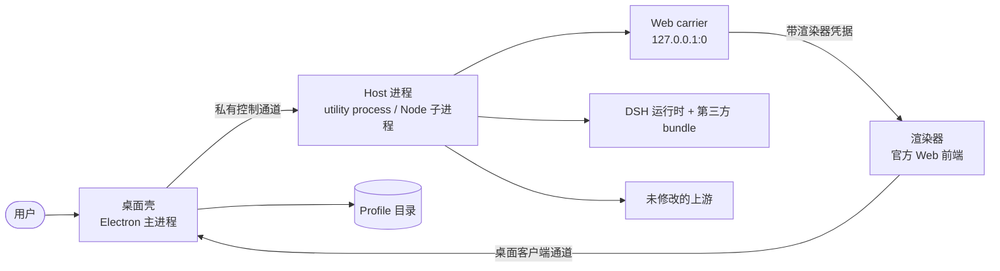

# DSH Desktop 架构

DSH Desktop 是围绕**未修改的 DeepSeek Harness 上游**构建的桌面产品：一个 Electron 桌面壳 + 一个跑官方 Web 应用的 Host 进程，前端仍是上游自己的渲染器。本仓库不改上游语义，只在进程边界、Profile 组合、打包与发行通道上补齐桌面形态需要的东西。

本文描述当前代码（HEAD `f89d121`，产品版本 2.1.18，DSH Beta 运行时 `0.2.1-rc.3`）的真实结构。凡本文与代码冲突，以代码为准。

## 总览



判据只有一句：**任何跨这一层边界的运行时状态都不能被缓存。**壳不假设 Host 里有什么插件、卡在哪一代、当前 profile 叫什么；Host 也不假设窗口还存在。两侧各持一份自己的状态，靠消息对齐。

仓库里有两个壳，它们是**两套不同实现**，共用同一个上游运行时：

| | `dsh-plugin-desktop-beta` | `nonead-dsh-desktop` |
| --- | --- | --- |
| 通道 | Beta（`dsh-plugin-desktop-beta`） | Stable（`nonead-dsh-desktop`） |
| Host 进程 | Electron `utilityProcess.fork` | Electron 以 `--expose-internals` 跑 Node 模式子进程 |
| 控制通道 | 私有 RPC（`{ kind, id, method, args }`） | Node 命名 IPC 消息（`process.send`） |
| 渲染器凭据 | 每代 32 字节 base64url，同款 HTTP 头 | 同款头，常量在 `src/desktop-contract.ts` |

两壳版本同步为 2.1.18，功能集合大体相同，但 Host 生命周期实现完全不同——只读一篇文档时请先看清它讲的是哪个壳。

## 启动顺序

以 Beta 壳为例（`dsh-plugin-desktop-beta/src/main.ts`）：

1. `app.requestSingleInstanceLock()`。拿不到锁就退出，第二个实例把参数交给已运行实例。
2. `await app.whenReady()`。之后才有 Electron 的窗口、托盘与原生 API。
3. `prepareDesktopProfile(...)`：解析 Profile 目录、合成有序补丁层、把 root config 写成 `[]`（若还不是），算出 `bareModuleBaseUrl`。这一步同时决定本次要用哪个市场 provider。
4. 若 `DSH_DESKTOP_ISOLATED_HOST !== '0'`（默认），`startIsolatedDesktopHost(...)` 起 Host 进程；设为 `0` 时在同一进程内直接 boot，仅供调试。
5. Host 侧依次：安装出站代理策略（必须早于 boot，因为插件在挂载时就可能发起请求）→ 建 Host 运行时桥 → 建渲染器访问判定 → 建 LAN HTTPS 运行时（`prepareCertificate` 通过 RPC 回调壳）→ `bootDesktopHost(...)` 加载补丁层并跑 profile boot → `mountScheduled()`。
6. carrier 绑 `127.0.0.1:0`（由系统分配端口），Host 把 `{ pid }` 作为 `boot` RPC 的结果返回。
7. 壳拿到带凭据的 URL，建窗口并让渲染器加载；随后注册托盘、更新生命周期等。
8. 窗口加载完成后才把这次启动记为 last-known-good；启动期失败不进 good 记录。

## 壳与 Host 之间的私有控制通道

### Beta 壳：utility process + 私有 RPC

Host 用 `utilityProcess.fork('./host-process-entry.js', [], { serviceName: 'DSH Host', stdio: 'pipe' })` 启动，入口只认 `process.parentPort`——拿不到就抛 `DSH Host must be started by the Desktop supervisor`，因此它**不能**被单独拿来跑。入口不 import 任何 `BrowserWindow` 或 Electron main API。

通道在 `src/host-rpc.ts`，消息形状只有三种：

```ts
{ kind: 'call',   id, method, args }
{ kind: 'result', id, value } | { kind: 'result', id, error }
{ kind: 'cancel', id }
```

`id` 必须是正安全整数，否则整条消息被丢弃。重复注册同名方法抛 `Duplicate Host handler: <name>`；调用不存在的方法抛 `Unknown Host operation: <method>`。默认超时 30 秒，Host 生命周期这两侧都按 120 秒构造。通道关闭时所有 pending 调用被拒绝。

方法集刻意很小：

- 壳侧注册 `certificate`（生成 LAN HTTPS 证书）与 `quit`（Host 请求退出时回调壳，`setImmediate` 里执行）。
- Host 侧注册 `status`（返回 `{ pid, services }`）、`stop`、`boot`（`args` 为 `[wire, snapshot, token]`）。

Web 流量**不经过**这条通道。

### Stable 壳：Node 模式子进程 + 命名消息

Stable 壳用 `spawn(node, ['--expose-internals', ..., entry, runtimeDir, projectDir, primaryRuntime, pnpm, nodeBin], { stdio: ['ignore','pipe','pipe','ipc'] })` 起 `@deepseek-ai/dsh-desktop-host`，靠 IPC 消息对齐。Host → 壳的消息有 `ready`、`fatal`、`platform-session`、`platform-login`、`injections`、`permission`、`logging-config`、`browser-access`、`notification`、`shutdown-complete`、`desktop-action`（`restart` / `terminal`）、`update-tasks`；壳 → Host 有 `shutdown`、`logging-config`、`browser-access`、`injections`、`update-tasks`（`inspect` / `lock` / `unlock`）、`permission-result`。每个事件都过一张白名单；形状不对就当故障处理（`dsh desktop host sent an invalid IPC event`），不发猜测性回复。请求类消息带 `requestId`，壳有 5–10 秒的等待窗口，超时即失败。

### 停止顺序

两侧都不信任"发一条消息就等于进程停了"。

Beta：`rpc.call('stop')`，3 秒内没回应就 abort 该调用 → `child.kill()` → 1 秒内没退就抛 `DSH Host termination was not confirmed` → 释放原生桥 → 关闭 RPC。

Stable：`shutdown` → 等 10 秒 → `SIGTERM` → 再等 5 秒 → `SIGKILL` → 再 5 秒还没退就抛 `dsh desktop host did not exit after SIGKILL`。正常退出路径要求"干净"退出时，不干净会抛 `DesktopHostUncleanExitError` 并带上 exit code、signal 与是否确认的诊断。

Host 非预期退出时，两侧都会把最后一段 stderr 带进桌面日志：Beta 保留尾部 16 KiB 并拼成 `退出原因 + Last DSH Host stderr: ...`；Stable 保留 64 KiB 诊断。Host 内部装的是 fail-loud 契约（`installFailLoud`）——未处理的拒绝不会让它带着半个状态继续服务，而是报告、释放本代持有的资源、退出 1。

### 渲染器凭据：进入 Host 的 HTTP 流量只有两类

carrier 只对两类请求放行：带正确渲染器凭据的（`renderer`）与被允许的普通浏览器（`browser`，仅在兼容模式且用户开了浏览器访问时）。其余一律 `denied`。

- 凭据是每代 32 字节随机数的 base64url 编码（43 字符），头名 `x-dsh-desktop-renderer`，比对用 `timingSafeEqual`。
- 请求 URL 的 query key 只要以 `dsh-desktop-` 开头，就视为渲染器标记；带标记却没有有效凭据的请求直接 403——避免凭据通过链接泄漏。
- 握手升级（WebSocket）同样判定：拒绝时回 `HTTP/1.1 403 Forbidden`。
- 凭据随 generation 更换，旧的立即失效。
- 凭据的传递：主进程生成后写进 Host 子进程的**私有 stdin**（一行、随即 `end()`），Host 在 argv 与 `process.send` 守卫之后读取并校验形状；**不进环境变量、argv 或文件**。管道不可用直接失败，不降级。
- Host 侧 HTTP 闸在缺凭据时**失败即拒绝**（记一条 `browser-access.unavailable` warn）：缺凭据就无法把 Electron 渲染器与普通浏览器区分开，放行等于打开浏览器访问。除 `/connect` 家族与只读方法外的变更请求另需 `connection.requestRejection` 通过。

## 平台适配

平台差异收敛在 `ElectronPlatformStrategy`（`src/electron-platform.ts`）一个 seam 上，启动时选定：`platform`、`updateDownloadPlatform`、`canPickDirectory`、`canToggleShellMode`、`hidesWindowOnClose`，以及 `configureApplication` / `refreshApplicationMenu` / `configureWindow`。

两处容易写错的地方：

- Windows 策略会 `window.removeMenu()`，菜单只存在于托盘与原生菜单路径上。
- **Linux 的 `hidesWindowOnClose` 是 `false`。**`new Tray()` 在 Linux 上总能成功，即使桌面根本没有状态区；此时隐藏窗口会让应用彻底不可达。所以 Linux 关闭窗口时是最小化——Host 与会话继续跑，窗口仍在窗口列表、alt-tab 与 overview 里。

### 窗口材质

材质按平台收窄：macOS 为 `off | transparent`（默认 `transparent`）、Linux 接受 `off | transparent`，但两者都解析为 `off`（默认 `off`）、**Windows 只有 `off`**。旧的 `acrylic` / `mica` 仍能被读出，但一律解析成 `off`——这两个 backdrop 与渲染器的合成会互相破坏。

## Profile、补丁层与配置写者

Profile 目录由 `@deepseek-ai/dsh-app-boot` 的 `resolveProfileDir(name, home)` 给出，位于 `<DSH_HOME>/profiles/<name>`。Beta 壳的桌面 profile 名固定，第一次启动时用 `ensureDesktopProfile` 建出来；其他名字只解析不创建。`list()` 只读，`select()` 先记 pending 再请求重启，UI 不会出现"看起来切了其实没切"。

### 补丁层顺序

`prepareDesktopProfile` 合成一条有序补丁列表：

1. 每个 active bundle 层自己的补丁（按 profile 里 `dsh.profile.bundles` 的顺序）。
2. 紧跟 `@deepseek-ai/dsh-web-app` 层之后，插入壳自己的覆盖层 `loadOverlayPatches(BIN_NAME, DESKTOP_PATCH_PATH)`。
3. 机级补丁 `loadDesktopMachinePatches(home)`，其中无法解析的可选条目会被 `omitUnresolvedOptionalEntries` 过滤掉。
4. 三段都过一遍市场 provider 过滤；出现 provider 冲突时这一代按 `disabled` 处理而不是猜一个赢家。

profile 少了 `@deepseek-ai/dsh-web-app` 会直接抛 `<bin>: desktop profile is missing @deepseek-ai/dsh-web-app`——与其半启动，不如报清楚。

### 两种补丁形态

```yaml
- id: web-runtime          # 按行 id 覆盖字段
  config:
    openBrowser: false
- insert:                  # 追加新行
    - id: example-capability
      name: example-plugin
```

`- id:` 是**字段覆盖**：`config` 整体替换该行的 config，`name` 被当作断言（不符就跳过）。`- insert:` 是追加一行 loader entry。

### 补丁失效的三种方式

补丁写错的代价与写法有关，这是这一层最容易踩的坑：

| 写错的地方 | 表现 |
| --- | --- |
| `id` 对不上任何行 | 打印 `entry not found` 警告，其余补丁继续生效 |
| `name` 与该行实际模块不符 | 打印 `name mismatch ... skipping`，该条被跳过 |
| `insert` 的 `name` 在运行时里不存在 | 该服务永远 pending、**没有警告**，外部表现为 HTTP 4xx |

第三种最隐蔽：没有报错，只是那半边永远起不来。排查顺序应该是先看 profile 里 insert 的模块名是否真能在解析路径里找到。

### 壳自己贡献的补丁层

- Beta 壳的 `cordis.patch.yml` 插入 `desktop-shell`（config `mode: compatibility`）、`desktop-terminal`（Linux 上 `disabled: !!js process.platform === 'linux'`）、`desktop-diagnostics`、`desktop-notifications`、`desktop-pnpm`、`desktop-profiles`、`desktop-updates`；随后按 id 覆盖 `web-runtime`（`openBrowser: false`、`printUrl: false`、`surfaceContext: true`、`trustedHosts: []`）并关掉 `command-feedback`。它同时在自己的 `config` 里指定 `host.cordis.patch.yml`，用来关掉上游 `webserver`、换成绑 `127.0.0.1:0` 的桌面实现。
- Stable 壳开回 `ui-sidebar-browser`、插入自己的能力行与皮肤，并显式关掉上游的产品分析（`desktop-product-telemetry`、`product-analytics`）——上游对名为 `desktop` 的 profile 默认上报，本产品不参与。

### Profile 目录与单写者锁

Profile 的读-改-写必须在**同一把写者锁**下完成（`src/recovery-support.ts`）。不加锁的周期会读到另一个写者已经替换过的状态再写回去，静默丢掉对方的修改。锁文件是 `<profile>/lock.lock`：独占创建、写入持有者 pid、持有进程消失时可被接管；与 `@deepseek-ai/dsh-atomic-write` 的 `withFileLock` 争的是同一把锁，因此进程内外的写者互相可见。等待上限 2 秒，重试间隔 20ms 起、200ms 封顶，并维护进程内深度表避免自锁与泄漏。

恢复模式在同一套锁下操作 Profile 快照，可以回到任一已保存的快照，而不是只能回退一步。

## 更新、恢复与桌面行为

- **发行说明**贯穿更新卡片、托盘提示与原生对话框。摘要取首个非空行、压平空白、按码点截到 120 字符；没有说明时留下的是与上次一致的文案，而不是 `undefined`。原生对话框不可取消，因此只在可中止的版本请求与文件状态都就绪后才弹出。
- **跳过版本**持久化在 `<userData>/next-updates/skipped-version.json`，只在进程启动时读一次。版本号必须匹配 `\d+.\d+.\d+` 加可选预发布后缀；记录坏掉时当作没跳过（坏数据不阻塞更新）。清除跳过是**写空对象**而不是删文件，以保持"只操作普通文件"的保证。
- **安装失败**可以重试，`retryInstall` 复用已下载的包，不重新下载。
- **窗口状态**持久化到私有目录：默认 1280×840、最小 800×580；保存的位置必须与某个已挂载显示器的 work area 至少有 160×80 的重叠才复用，否则回落到默认位置。move/resize 以 500ms 合并写入，损坏或越界的记录一律回落默认。
- **严格 `.env` 分层**：桌面只**补齐 Host 子进程缺失的变量**，不覆盖已有值。只认 `KEY=VALUE`，没有展开、转义或行内注释；同一 KEY 首次赋值生效；每一行被跳过的内容各发一条警告（带行号），不静默吞掉。
- **`dsh-desktop://` 深链接**：`src/deep-link.ts` 解析 `dsh-desktop://settings/general`、`dsh-desktop://open?path=/x`、`dsh-desktop:open` 三种形态；action 小写、重复 query key 取第一个、空 action 视为 malformed。`src/preload-deep-link.ts` 把链接投给渲染器，并对消息做结构校验。actions 走白名单（`DEEP_LINK_ACTIONS = ['settings', 'open']`）：主进程在**入队之前**丢弃未知 action 并记一条 warn，因此 `did-finish-load` 的重放也绕不过去——任意本机进程都能发 `dsh-desktop://<任意action>`，白名单是这条通路上唯一的约束。
- **开机自启**（`src/login-item.ts`）：读取失败即视为关闭，绝不声称一个不存在的启动项；写入后回读真实状态再返回。
- **渲染器未处理错误**进通知区，而不是消失在一个没人看得到的 console 里。

## 打包与运行时闭包

打包是 electron-builder。**稳定壳**（`asar: true`）产物为 `app.asar` + `app.asar.unpacked`；**Beta 通道**用物理目录分发（`asar: false`），产物是 `resources/app/` 下的普通文件树，所以 `asarUnpack` 对它没有意义——`dsh-plugin-desktop-beta/tests/package.spec.ts` 断言 `build.asar === false` 且不得出现 `asarUnpack`。稳定壳另有一步独立于 electron-builder 的 payload 组装（`nonead-dsh-desktop/scripts/prepare-payload.ts`）：先跑一遍 electron-builder 自己的 manifest transformer（这样封印的字节就是最终字节），再按 Node 解析路径收集生产闭包，最后 `sealPayload` 写一份 `desktop-runtime.json`（`schemaVersion: 1`，逐文件 `{ path, bytes, sha256 }`）。

四条边界：

- 生产闭包 = `dependencies` + 非可选 peer + 已安装的 optional。
- 只接受字面名与 `目录/**`，其余 `files` 写法直接拒绝。
- 纯类型依赖降级为 optional peer 或 devDependencies，不进闭包。
- 落点由"从依赖方解析"决定（`createRequire(...).resolve.paths`，只认 basename 为 `node_modules` 的目录，不走 `exports`），因此 hoisting 布局变化不会让 payload 悄悄换文件。

## 发行通道协议

`upstream.json` 定两条通道：

| 通道 | vendored 运行时 | 上游 commit | workspace 包 |
| --- | --- | --- | --- |
| stable | `0.2.0-rc.2` | `639ed015` | `nonead-dsh-desktop` |
| beta | `0.2.1-rc.3` | `1f81c047` | `dsh-plugin-desktop-beta` |

边界说明：

- 通道名等于 vendored runtime 的线，不等于 workspace 目录后缀；`-beta` 后缀是包名，不是"选了 Beta 通道"。
- 更新请求带 `X-DSH-Desktop-Channel`、`X-DSH-Desktop-Version`，下载时带 `X-DSH-Desktop-Target-Version`。稳定通道只接受正式 SemVer；Beta 通道接受 `-beta.N`；缺通道头的旧客户端按稳定版处理。

## 已知限制

- **`insert` 指向不存在的服务名会静默 pending**（见上文表格第三行）：没有警告，只有外部症状。
- **`Resources/runtime` 的解释器树不在 payload 封印范围内**：`desktop-runtime.json` 覆盖的是应用侧 payload，Python/解释器那一棵树由别的路径安装，摘要不覆盖它。
- **`payloadDigest` 只写不校验**：`runtime.json` 里记的摘要目前没有在启动时被重新计算比对，完整性靠随包封印与服务端摘要（后者尚未发布）。
- 上述校验都在稳定壳（`nonead-dsh-desktop/src/update-installer.ts`）；Beta 壳没有这个模块，下载侧只验魔数与大小后直接执行。
- **Windows 只有 PE 版本资源比对**：2.1.15 曾引入更严格的签名/发布者校验，随后在 `c5896ac` 整条撤销；当前不做 Authenticode 校验，也不校验发布者身份。
- macOS 侧校验更强：bundle 标识、manifest、代码签名与 Team Identifier 都参与，校验失败走 Squirrel.Mac 的失败路径。
- 服务端尚未发布安装包摘要，下载完整性的最终判据仍只有随包封印。
- **Electron fuses 的真实取值只能在打包产物上观测**：`verify-fuses` / `verify-electron-fuses` 目前只有单元测试覆盖，真实取值由 `afterPack`/`afterAllArtifactBuild` 在打包产物上校验，首次真正确认点是 CI 的 `desktop-windows-stable` 作业（`corepack yarn package:dir:stable`）。`enableEmbeddedAsarIntegrityValidation` 因此保持关闭——electron-builder 26.15.7 无法证明会把完整性 blob 注入可执行文件（`patches/app-builder-lib@26.15.7.patch` 不含相关代码），而 Windows/Linux 产物未签名，盲开会让应用起不来。

## 相关文档

- [插件开发](plugin-development.md)
- [插件生态](plugin-ecosystem.md)
- [常见问题](faq.md)
- [桌面壳服务参考（Beta）](../dsh-plugin-desktop-beta/docs/plugin-services.zh.md)
- [上游 DeepSeek Harness](https://github.com/deepseek-ai/deepseek-harness)
