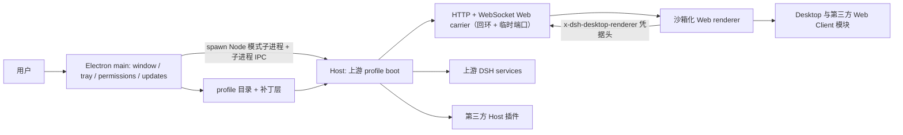

# DSH Desktop 架构

## 总览

DSH Desktop 是一个薄的 Electron 宿主，由两部分组成，运行在不同进程里：

- **桌面壳（Electron main 进程）**：窗口、托盘、权限、终端、更新、数据目录和 profile 状态。
- **Host（Node 模式子进程）**：用当前安装包自带的运行时，跑上游 profile（`@deepseek-ai/dsh` 的 profile boot），再通过 HTTP/WebSocket Web carrier 提供官方 Web UI。

两者之间只有一条子进程 IPC 通道。Desktop 没有另造一条 renderer 插件系统，也不把 Electron API 暴露给页面：渲染器拿到的是官方 Web UI，加一个由原生凭据头区分的访问权。

判据：**任何跨这一层的状态都不能缓存**。shell 与 Host 是两个进程，profile 或模式切换会 dispose 整个 Host generation 并换一个新的子进程；Service reference、窗口对象、subprocess handle 都不跨 generation。

## 启动顺序

1. Electron 获取单实例锁，解析数据目录，再读取 Desktop 私有的 profile/mode 状态。
2. 桌面壳准备激活 profile（必要时初始化），但不会为了列举 profile 而改写用户 profile。
3. 壳把当前 generation 的运行时目录、profile 目录、primary runtime、打包的 pnpm 与 Node shim 目录作为 argv 传给 Host 子进程，并以 Node 模式 spawn 它。
4. Host 子进程加载 profile 的补丁层，启动上游 profile boot。Desktop 自有 capability 行在第三方插件可读取前注册。
5. 官方 `dsh-base`、`dsh-web-app` 和 profile 选中的第三方 bundle 组成 Web carrier。
6. carrier 绑定回环地址（LAN 暴露需要显式偏好），端口由偏好决定，默认 `0` 即由系统分配一个临时端口。
7. Host 把带凭据的 URL 和 Web boot injections 通过 IPC 交回壳；壳创建 `BrowserWindow` 并加载该同源页面。
8. Web surface 成功加载后才创建托盘并提交 profile 的 last-known-good 状态。

## 桌面壳、Host 子进程与访问边界

### Host 是子进程，不是壳内的 generation

Host 由壳以 `--expose-internals` 启动，入口是运行时目录里的 `@deepseek-ai/dsh-desktop-host`，参数依次是运行时目录、profile 目录、primary runtime 目录，以及打包的 pnpm 与 Node shim 目录。它的生命周期归壳所有：`stop()` 先请它优雅退出（`shutdown` 消息），10 秒未退则 `SIGTERM`，再 5 秒不退则 `SIGKILL`；更新安装要求"优雅退出"时，任何一步降级都记为失败并拒绝安装。

### IPC 通道上流动的消息就是这一层的公开面

壳与 Host 之间只有 `process.send` / `process.on('message')` 这一条通道，两侧都对消息做结构校验，未知形状会被当作 Host 故障处理。当前存在的消息类型分三类：

- **Host → 壳**：`ready`（带凭据的 URL + Web boot injections）、`fatal`（错误消息 + 完整诊断）、`shutdown-complete`、`notification`、`desktop-action`（`restart` / `terminal`）、`update-tasks` 应答、`injections` 应答、`logging-config` 应答、`browser-access` 应答、`permission`（壳回 `permission-result`）、`platform-session`、`platform-login`。
- **壳 → Host**：`shutdown`、`logging-config`、`injections`、`browser-access`、`permission-result`、`update-tasks`。
- **Host 启动参数**：运行时目录、profile 目录、primary runtime 目录、pnpm 入口与 Node shim 目录。

判据：**插件不要试图自己开第二条 IPC 通道，也不要直接读这些消息。** 这是壳与 Host 的私有握手；桌面能力走 `desktopProfiles` / `desktopPnpm`（见[插件开发](plugin-development.md)）。

### 渲染器访问由原生凭据头区分

Host 默认只绑定回环地址，端口默认由系统分配，因此"能连上端口"不足以证明请求来自本机 Electron 渲染器。壳为每个 Host generation 生成一个 32 字节 base64url 随机凭据，通过 `x-dsh-desktop-renderer` 请求头下发；Host 侧的 Web 服务器按三种结局分类每个 HTTP 与 upgrade 请求：带正确凭据 = `renderer`，未开启普通浏览器访问或 URL 带 `dsh-desktop-` 前缀的渲染器标记 = `denied`（403），其余 = `browser`。

`browserAccess` 关闭时，已有浏览器 WebSocket 会被主动断开，而原生渲染器连接保持存活；带渲染器标记的 URL 永远不能从普通浏览器激活 Desktop 专属客户端效果。

## 平台 adapter

平台差异集中在 `ElectronPlatformStrategy` 这一处 seam，启动时选定一次。Windows、macOS 与 Linux adapter 声明目录选择、Shell 模式切换和更新下载能力，并负责各自的菜单、Dock 图标与原生材质操作。新的平台分支应进入对应 adapter；generation 与 runtime 中只保留各平台共享的生命周期流程。

窗口材质按能力开关收敛：macOS 与 Linux 接受 `off` / `transparent`，Windows 只接受 `off`（历史偏好里的 `acrylic` / `mica` 读作 `off`），Linux 的 `transparent` 会因为上游兼容客户端画不透明底色而失败回落到 `off`。

## Profile 目录与补丁层

profile 的名字和绝对目录是 `$DSH_HOME/profiles/<name>`，由壳决定并通过 argv 交给 Host，不能从 settings、URL 或 `$DSH_HOME` 反推。`list()` 是只读发现；`select()` 记录 pending target，并通过重启完成切换。

### 补丁按 row id 命中，写错不会报错

profile 的组合方式是补丁层叠加，顺序是：**每个 bundle 自己的补丁 → profile 目录里的用户补丁 `cordis.patch.yml` → launcher 提供的覆盖层**（运行时目录里的 `host.cordis.patch.yml`、壳生成的 profile 覆盖补丁、以及由偏好派生的运行时补丁）。

一条补丁有两种形态，语义完全不同：

- **`- id: <row id>` + 字段覆盖**：按 **row id** 命中已存在的行，替换给出的字段（`config` 是整体替换，不是深合并）；`name` 是断言而不是改名——写错即跳过。
- **`- insert: [...]`**：追加新行；带 `id` 时插入到该 id 的 group 内部，不带 `id` 时追加到顶层。

**判据：row id、包名或注入服务名写错都不会抛错，只会静默失效。** 具体表现分三种，排查时按这个顺序看：

| 写错的东西 | 实际行为 |
| --- | --- |
| 补丁的 `id` 不匹配任何行 | Loader 记录一条 `entry not found` 警告后跳过该补丁；启动照常 |
| 补丁的 `name` 与目标行不符 | Loader 记录 `name mismatch ... skipping` 后跳过该补丁 |
| 插件的 `inject` 服务名不存在 | 该插件永远不激活（pending），不产生警告；它的路由、命令、工具全部不存在 |

第三种是最难查的一类：界面只表现为"某些接口莫名 4xx"，日志里没有对应错误。排查看两处配置示例：桌面壳自己贡献的 [`nonead-dsh-desktop/cordis.patch.yml`](../nonead-dsh-desktop/cordis.patch.yml)（按 `id` 关掉上游行，再用 `insert` 加入自己的行）与 [`dsh-plugin-desktop-beta/cordis.patch.yml`](../dsh-plugin-desktop-beta/cordis.patch.yml)。

### 壳贡献了哪些补丁层

- **运行时的 `host.cordis.patch.yml`**：关掉上游 `webserver` 行，换成一个只监听 `127.0.0.1`、端口 `0` 的自有 Web 服务器行。
- **每次启动重写的运行时补丁**：把偏好里的端口和壳解析出的 trusted hosts 写进行配置，因此改端口是"重启 Host"而不是"重启应用"的边界。
- **壳自己的 bundle 补丁**：声明桌面壳这个 bundle 关掉了哪些上游行、插入了哪些行。

## 打包与运行时闭包

发布包使用 Electron Builder 和 `app.asar`，但需要物理 unpack 的依赖（例如 pnpm、node-pty、Windows ACL/native 文件、`node-bin` shim 目录）会放在 `app.asar.unpacked`。Packaged runtime gate 会检查 ASAR 入口和物理运行时入口，profile fallback 不能把符号链接指向无法被 Node 解析的虚拟 ASAR 路径。

桌面的 payload 不是交给 Electron Builder 临时推导的，而是由 [`nonead-dsh-desktop/scripts/prepare-payload.ts`](../nonead-dsh-desktop/scripts/prepare-payload.ts) 先独立组装、再用摘要封印，Electron Builder 只是把它搬进安装包。三条边界值得插件作者记住：

- **生产闭包 = `dependencies` + 非可选 `peerDependencies` + 已安装的 `optionalDependencies`。** 一个 workspace 包只要它在磁盘上的真实路径不含 `node_modules`，就走"按 `files` 列表发布"的拷贝路径；否则整棵目录树被复制。
- **`files` 里只接受字面名和 `目录/**`。** 任何其它 glob（例如 `lib/*.js`）会让构建直接失败，而不是猜一个近似结果。
- **本地插件的纯类型依赖必须降为可选 peer 或只留在 `devDependencies`。** 只被类型引用到的包如果留在 `dependencies`，就会被当成运行时依赖打进安装包，在用户的 profile 里白白占体积，还可能因为版本冲突让闭包收集报错。
- **`node_modules` 的落点由"从依赖方解析"决定。** 同一个包被两个不同的依赖容器解析到，会在两处各放一份；同一个落点被两个不同实体声明会直接失败。所以本地插件的依赖版本必须与安装包内已有的版本一致，或明确写成可选。

封印之后，安装包内的 payload 再被独立校验（文件摘要 + 可执行文件类型），所以"构建成功"和"装机后仍然完整"是两个分别有证据的结论。

两条已知缺口：`Resources/runtime` 下的解释器树（Python、Node 与解包后的 wheel）不在上面的封印范围内；`runtime.json` 里的 `payloadDigest` 目前只写不校验，而且它是在 Python 剪裁重写目录**之前**算出来的——所以在调整写入顺序之前，它不能当作装机后的内容级证据。

## 发行通道协议

`upstream.json` 记录各通道的上游版本、提交和 vendored runtime 清单，根级精确 resolution 保证每个 workspace 只能解析自己的 DSH 运行时。当前它记录两条 vendored runtime 线：

| `upstream.json` 通道 | 上游版本 / commit | 消费方 | 产品标识 |
| --- | --- | --- | --- |
| `stable` | `0.2.0-rc.2` | `dsh-plugin-desktop-beta` | `dsh-plugin-desktop-beta`、`DSH Desktop Beta`、`ai.deepseek.dsh.desktop.beta` |
| `beta` | `0.2.1-alpha.5` | `dsh-plugin-desktop-beta`；桌面壳内**冻结**一份同版本运行时 | `Nonead DSH Desktop`、`ai.deepseek.dsh.desktop` |

> 两条容易混淆的边界。**① `upstream.json` 里的通道名是"vendored runtime 线"**，它决定哪个上游运行时被打进哪个安装包，而不是某个工作区查询哪个发布通道。桌面壳把自己的所有 `@deepseek-ai/dsh*` 依赖精确 pin 到 `0.2.1-alpha.5`（即 `beta` 线），并把该运行时随包**冻结**；因此壳的运行时版本不随后续更新查询变化。
> **② 工作区后缀不是通道。** `nonead-dsh-desktop` 的脚本后缀是 `:stable`，但那是工作区命名；它自己的更新查询固定声明 `channel: 'stable'`，与产物前缀 `Nonead-DSH-Desktop-*` 和纯 SemVer 版本号（当前 `2.1.3`）一致——稳定通道只接受正式 SemVer，所以这三者必须一起改。

版本检查和安装包下载均携带 `X-DSH-Desktop-Channel`。检查请求还携带当前版本（`X-DSH-Desktop-Version`）；下载请求携带 `X-DSH-Desktop-Target-Version`，服务端必须返回与请求一致的通道与版本。没有通道 header 的旧客户端按稳定版处理；`beta` 客户端必须收到明确的 `channel: "beta"` 响应。稳定通道只接受正式 SemVer，Beta 通道只接受 `-beta.N`。通道隔离由响应里的 `channel` 字段把关，客户端不会静默跨通道下载。

服务端必须在发布前先支持上述选择与回显规则，并为对应通道准备完整的平台产物。

## 已知限制

- **`inject` 服务名写错 = 静默 pending**（见上文表格）。依赖一个当前运行时并不存在的服务名时，插件永远不激活，宿主不会报错，界面表现只是莫名的 HTTP 4xx。
- **Windows 更新包目前只校验 PE 版本资源。** 安装器会读取 `ProductName` 与 `ProductVersion` 并与期望版本比对，但没有密码学摘要校验。下载路径**支持**服务端发布的 `installerSha256` 并按硬门禁执行，但当前版本端点还不发布该字段，所以这条校验事实上待服务端先发布 sha256 才能启用。
- **macOS 更新路径的校验强度与 Windows 不同**：它验证磁盘映像内的 bundle 标识、内嵌 manifest 与版本、安装副本与新副本的代码签名和 Team Identifier，再交给 Squirrel.Mac 安装。
- **服务端尚未发布摘要前，安装包完整性只有"随包封印摘要"这一层证据**，不是端到端签名验证。

## 维护者深入阅读

- [Desktop service contract](../dsh-plugin-desktop-beta/docs/plugin-services.md)
- [Package README](../dsh-plugin-desktop-beta/README.md)
- [Pinned upstream and isolated Yarn workspace](../.agents/notes/implemented/process/2026-08-15-pinned-upstream-and-isolated-yarn-workspace.md)
- [Profile and pnpm services decision](../.agents/notes/implemented/architecture/2026-08-15-desktop-profile-and-pnpm-services.md)
- [Advanced shell decision](../.agents/notes/implemented/architecture/2026-08-15-desktop-advanced-shell.md)
- [Native shell generation and platform adapters](../.agents/notes/implemented/architecture/2026-08-19-native-shell-generation-and-platform-adapters.md)
